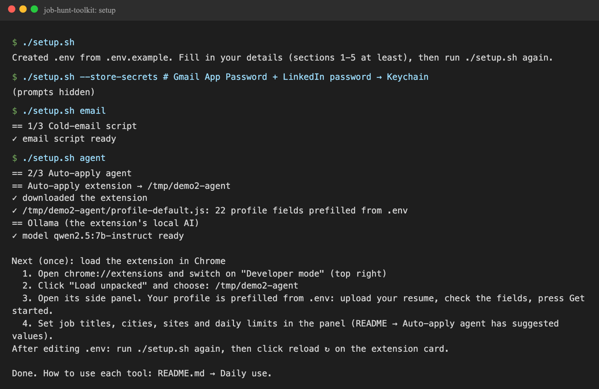
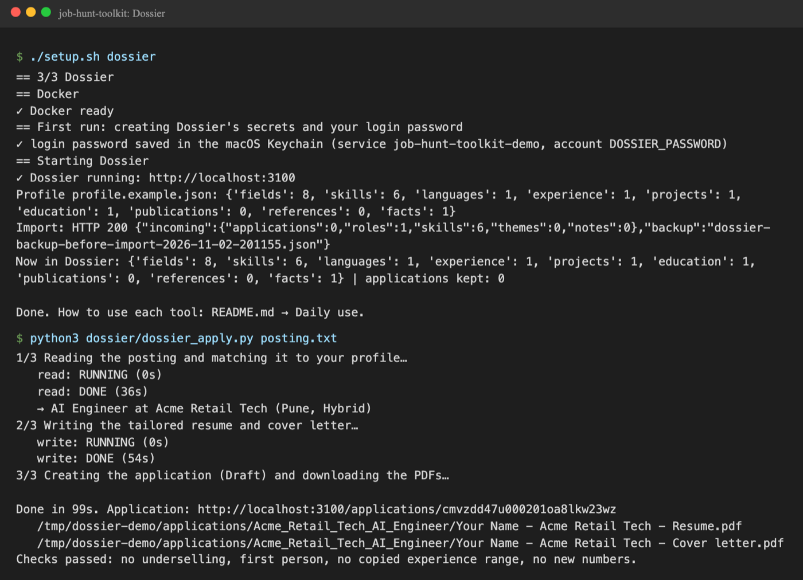
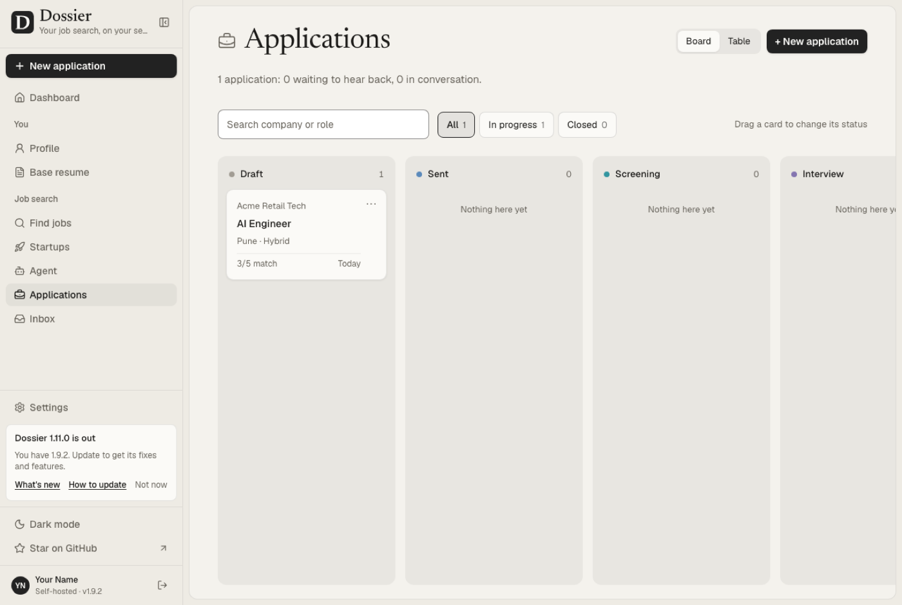
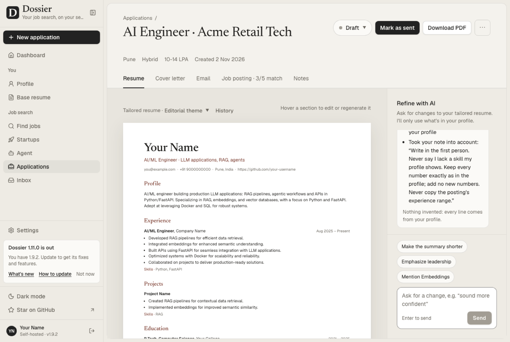
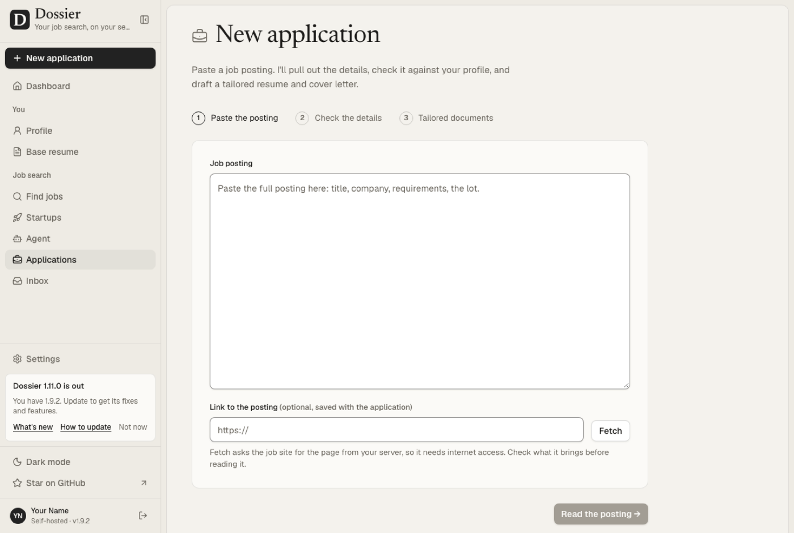

# Job-hunt toolkit

Three tools that run your job search from your own Mac, all configured from **one `.env` file**:

| Tool | What it does | Runs on |
|---|---|---|
| **1. Cold-email script** (`email-script/`) | Searches LinkedIn posts for "hiring …" in your roles, keeps the ones that fit (role, city / remote, real companies, no agencies), and emails each hiring address your résumé with your message. Never emails the same address twice. | Python + Chrome + Gmail |
| **2. Auto-apply agent** (`autoapply-agent/`) | Sets up an open-source auto-apply Chrome extension (one that runs on a local Ollama model and fills in job applications on **Naukri, Indeed and LinkedIn**) and prefills its profile from your `.env`. | Chrome + a local AI model (Ollama) |
| **3. Dossier** (`dossier/`) | Paste a job posting and get a résumé and cover letter tailored to it (PDFs), tracked as an application. | Docker + Ollama, at `http://localhost:3000` |

Everything personal (name, contact, CTC, notice period, answers to screening questions, email text, the roles and cities you want) lives in `.env`. That file is git-ignored: it never leaves your machine.

---

## 1. What you need

- **A Mac** (tested on macOS 15/26, Apple Silicon). Linux works for tools 1 and 3 with small changes; the Keychain steps are macOS-only.
- **8 GB RAM minimum, 16 GB recommended.** The local AI model uses about 5.5 GB while it works.
- [Homebrew](https://brew.sh), then:
  ```bash
  brew install python git ollama poppler          # poppler = pdftotext, for reading resumes
  brew install colima docker docker-compose       # or install Docker Desktop instead
  ```
- **Google Chrome**.
- **A Gmail App Password** for sending email: Google Account → Security → 2-Step Verification → App passwords. (Your normal password won't work.)
- **A LinkedIn account** for the email script. A second account is safer: scraping can get an account temporarily restricted.

## 2. Set up from scratch (about 20 minutes)

```bash
git clone https://github.com/<you>/job-hunt-toolkit.git
cd job-hunt-toolkit

./setup.sh                 # first run: creates .env from .env.example and stops
open -e .env               # fill in sections 1-5 (see "The .env file" below)
./setup.sh --store-secrets # Gmail App Password + LinkedIn password → macOS Keychain
./setup.sh                 # sets up all three tools
```

`./setup.sh` is safe to re-run at any time: it only does what's missing. To set up one tool: `./setup.sh email`, `./setup.sh agent` or `./setup.sh dossier`.

**Auto-apply agent:** set `AGENT_REPO` in `.env` to the git URL of the extension you use (see
[Auto-apply agent](#auto-apply-agent) below for what it needs), then run `./setup.sh agent`. Then, once, **load it into Chrome**:
1. Open `chrome://extensions` and switch on **Developer mode** (top right).
2. Click **Load unpacked** and choose the folder printed by setup (default `~/job-hunt-agent`).
3. Pin the extension and open its side panel.

**Dossier:** for your profile, copy `dossier/profile.example.json` to `dossier/profile.json` and fill it in from your résumé, then run `./setup.sh dossier`. You can also fill in the Profile page inside Dossier.

What a successful setup looks like (demo profile; your paths and names will differ):



## 3. The `.env` file

One file, seven sections. Everything is explained inline in `.env.example`.

| Section | What goes in it | Used by |
|---|---|---|
| 1. Who you are | name, email, phone, city, LinkedIn/GitHub URLs, current title | all |
| 2. Screening answers | total years, current/expected CTC (₹ and LPA), notice period, relocation, passport, night shifts, skills, education, reason for change, **ANSWER_BANK** (prepared true answers, one per line) | agent profile, emails |
| 3. Resume | path to your résumé PDF, the attachment's file name | email script |
| 4. The jobs you want | **TARGET_ROLES**, **TARGET_CITIES**, max years asked, role words | email script |
| 5. Email script | LinkedIn login email, sender email, search queries, the two email templates, daily cap, domains never to email | email script |
| 6. Agent | the extension's git URL, where to put it, the Ollama model | agent |
| 7. Dossier | URL, AI model, tone, profile file, the standing note sent with every application | Dossier |

Rules of the format:
- `KEY=value`, one per line. Lines starting with `#` are comments.
- Multi-line values (email bodies, lists) go in `"double quotes"` and can span lines.
- `${OTHER_KEY}` inside a value is replaced, e.g. `EMAIL_APPLICATION_SUBJECT=Application: ${TARGET_TITLE} | ${FULL_NAME}`.
- Passwords: leave `SENDER_PASS` / `LINKEDIN_PASS` empty and use `./setup.sh --store-secrets`, so they live in the Keychain instead of a text file.

**Answer truthfully.** The emails and the agent's profile use exactly what you write here. Inflated years or numbers you can't back up will hurt you in the interview.

## 4. Daily use

### Cold-email script
```bash
cd job-hunt-toolkit/email-script
python3 script.py            # today's posts (last 24 h) for your SEARCH_QUERIES
python3 script.py --week     # last 7 days: use after a break
python3 script.py --city     # only your on-site / hybrid CITY_QUERIES, past week
python3 script.py --explore  # test queries from data/logs/explore_queries.txt; sends nothing
python3 script.py --force    # a second LinkedIn session the same day (riskier)
```
- A Chrome window opens. The first time, log in to LinkedIn in it; the session is remembered in `DATA_DIR/chrome_profile_bot`.
- The run log and a summary (found / sent / skipped and why) are in `DATA_DIR/logs/`.
- Built-in safety: at most `SEND_DAILY_CAP` emails a day, 25-45 s between emails, one email per company per run, a LinkedIn usage limit that grows slowly week by week, and an automatic pause if LinkedIn shows a rate-limit warning.
- Addresses already emailed are kept in `DATA_DIR/sent_emails.txt` and never emailed again. Back this file up.

### Auto-apply agent

**What it needs.** Any open-source auto-apply Chrome extension (Manifest V3, loaded unpacked) that uses a local Ollama
model and reads optional profile defaults from a `profile-default.js` file of the form
`window.AA_DEFAULT_PROFILE = {firstName, lastName, email, phone, city, currentTitle, totalYears, skills, currentCtc,
expectedCtc, noticeDays, education, notes, …}`. Put its git URL in `AGENT_REPO`. `./setup.sh agent` downloads it into
`AGENT_DIR`, writes that file from your `.env` (`autoapply-agent/build_profile.py`), and readies Ollama.
If your extension uses other field names, edit the `profile` dict in `build_profile.py`.

**Use it:**
1. Log in to Naukri, Indeed and LinkedIn in the Chrome profile where the extension is loaded.
2. Open its side panel. Your profile is prefilled from `.env`; upload your résumé there once, check the fields, save.
3. Enter your job titles (from `TARGET_ROLES`) and cities in the panel's search settings.
4. Start in a look-only or confirm-each-submit mode if it has one, and only then let it apply automatically.
5. Keep the Chrome window visible while it runs (Chrome slows down hidden windows).

Suggested limits so your accounts stay safe: about **100 a day on Naukri and Indeed, 25 per run on LinkedIn**.

### Dossier (tailored résumé + cover letter)
```bash
cd job-hunt-toolkit
pbpaste | python3 dossier/dossier_apply.py -                 # posting text copied to the clipboard
python3 dossier/dossier_apply.py posting.txt --tone WARM     # from a file
python3 dossier/dossier_apply.py --link https://...          # Dossier fetches it (some job sites block this)
```
Each run takes about 2-6 minutes on the local model, depending on your profile's size. It creates a **Draft** application in Dossier (nothing is sent) and saves `Resume.pdf` and `Cover letter.pdf` in `DOSSIER_DIR/applications/<company>_<role>/`. The script checks the documents for underselling, third-person writing, a copied experience range and numbers that aren't in your profile. It rewrites once if it finds any, and lists what's left for you to fix.

**Always read the cover letter before you send it.** Here's a full run on a demo posting, and the result in Dossier:







You can also paste a posting in Dossier itself (**New application**) instead of using the script:



To review or edit a letter, open `http://localhost:3000`, then mark the application as sent once you've sent it. The login password is in the Keychain (service from `KEYCHAIN_SERVICE`, account `DOSSIER_PASSWORD`):
```bash
security find-generic-password -s <KEYCHAIN_SERVICE> -a DOSSIER_PASSWORD -w
```

## 5. Set it up for your job role

Only `.env` changes. Example: switching from AI engineer roles in Pune to **data scientist roles in Bangalore or remote**:

```ini
TARGET_TITLE=Data Scientist
TARGET_ROLES="Data Scientist
Machine Learning Engineer
Applied Scientist"
TARGET_CITIES=bangalore|bengaluru
ROLE_WORDS=data scien\w*|machine learning|ml|statistic\w*|analytics|ai
SEARCH_QUERIES="hiring data scientist remote India
hiring data scientist Bangalore"
CITY_QUERIES="hiring data scientist Bangalore"
```
Then update the email templates (section 5), the answer bank and skills (section 2), your Dossier profile and the agent panel's job titles, and run `./setup.sh`.

Tips:
- **LinkedIn post search wants short queries:** `hiring <role> <place>`. Long queries return nothing.
- **Be honest about your level:** applying to senior roles with one year of experience wastes your daily limits.
- **`STRICT_FIT=false`** in the email script emails every Indian company, including IT-services firms and agencies. More volume, lower quality.

## 6. After you change something

| You changed | Do this |
|---|---|
| `.env` (any section) | `./setup.sh` (rewrites the agent's profile defaults, re-checks everything) |
| Agent profile | then click **reload ↻** on the extension at `chrome://extensions`. The values only fill empty fields: anything already saved in the panel wins. To start from `.env` again, clear the profile in the panel (or remove and re-add the extension). |
| `dossier/profile.json` | `python3 dossier/import_profile.py` (only the profile is replaced; your applications are kept, and Dossier makes a backup first) |
| A new résumé | update `RESUME_PDF`, upload it in the agent panel, update the Dossier profile |

Stop or start Dossier: `cd ~/dossier && docker compose down` / `docker compose up -d`. Update it: `docker compose pull && docker compose up -d`.

## 7. Troubleshooting

| Problem | Fix |
|---|---|
| `Gmail rejected the login` | Use a Gmail **App Password**, not your account password; store it with `./setup.sh --store-secrets`. |
| LinkedIn shows "you've reached the limit" or asks to verify | The script pauses itself for 3-7 days. Don't force it. Use `--week` when it resumes. |
| Agent says it can't reach the AI | Restart the Ollama app (setup allowed Chrome extensions with `OLLAMA_ORIGINS`), check `ollama list` shows `OLLAMA_MODEL`. |
| Agent is very slow | Keep its Chrome window visible; close other heavy apps; don't run Dossier at the same time (they share the model). |
| Dossier PDF fails / app restarts | It needs `mem_limit: 2g` (in `compose.override.yml`) and, on Apple Silicon with Colima, Rosetta: `colima start --vm-type vz --vz-rosetta --memory 6`. |
| Dossier write step times out | Raise `DOSSIER_AI_TIMEOUT_SECONDS` in `DOSSIER_DIR/.env` (default 600), then `docker compose up -d`. |
| Cover letter undersells you | Add facts to your Dossier profile, and add a sentence to `DOSSIER_NOTE` in `.env`. |

## 8. How it fits together

```
job-hunt-toolkit/
├── .env.example          template: copy to .env (git-ignored) and fill in
├── toolkit_env.py        reads .env for all three tools (passwords: env → .env → Keychain)
├── setup.sh              one-command setup / re-check
├── email-script/
│   ├── script.py         LinkedIn posts → filtered hiring emails → Gmail
│   └── requirements.txt
├── autoapply-agent/
│   ├── build_profile.py  .env → the extension's profile-default.js (prefilled profile)
│   └── setup_agent.sh    download the extension (AGENT_REPO) → build profile → Ollama model
└── dossier/
    ├── compose.yml, compose.override.yml   Dossier + Postgres in Docker
    ├── setup_dossier.sh  secrets + login password (Keychain) → start → import profile
    ├── import_profile.py profile.json → Dossier (keeps your applications)
    ├── dossier_apply.py  posting → tailored résumé + cover letter → PDFs
    └── profile.example.json
```

## 9. Extending it

Want to add a filter, a screening-answer rule, a job site or a fourth tool? See **[docs/EXTENDING.md](docs/EXTENDING.md)**:
where each behaviour lives in the code and how to add a setting to `.env`.

## Credits

- **Auto-apply agent:** the extension isn't part of this repository; the toolkit only downloads the one you choose (`AGENT_REPO`) and prefills its profile. Respect its author's license.
- **Dossier:** [AienTech/dossier](https://github.com/AienTech/dossier), used unmodified through its Docker image.

## License

[MIT](LICENSE). This covers the toolkit's own code; Dossier and the auto-apply extension keep their own licenses.
